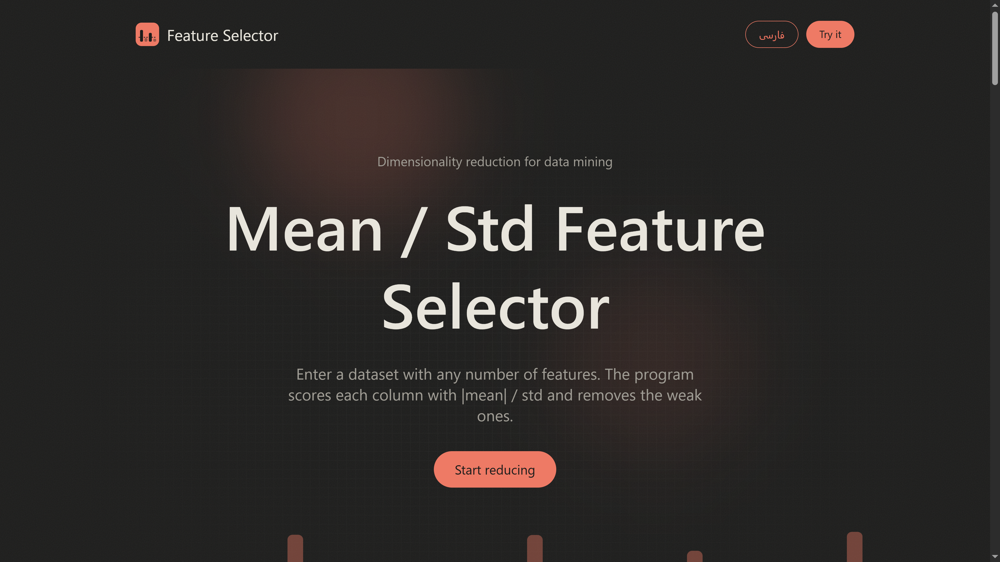

# Feature Selector

Interactive dimensionality-reduction tool. It scores every column of a dataset with the **mean-to-standard-deviation index** and removes the weak ones.

**Live demo:** _add your Vercel link here_



## How it works

For each column `j`:

```
J_j = |mean_j| / std_j        (sample std, n - 1)
keep column j  if  J_j >= threshold
```

A column whose mean is small compared with its spread is centred around zero and carries little signal, so it is removed. The threshold is the average of all indices by default (automatic), or you can set it by hand.

## Features

- Any number of rows and columns (up to 12), editable column names
- Import CSV, download the reduced dataset as CSV
- Sample, Iris and random datasets
- Live pipeline: Input, Calculation and Result stay on screen and update as you type
- English and Persian (RTL) interface, responsive layout
- Unit-tested statistics core, verified against hand calculations

## Stack

Next.js, TypeScript, Tailwind CSS, TanStack Table, Vitest

## Run locally

```bash
npm install
npm run dev     # http://localhost:3000
npm test        # unit tests
npm run build   # production build
```

## Project structure

```
lib/stats.ts      mean, std, index, automatic threshold
lib/data.ts       sample data, CSV parsing and export, random data
components/       Tool (the app), Hero background, diagrams, logos
app/              page, layout, styles
lib/i18n.ts       English and Persian texts
```

## Known limitations

The index ignores class labels and correlation between columns, and it changes if a constant is added to a column. Possible next steps: z-score option, class-aware index, comparison with variance threshold.

## License

MIT
